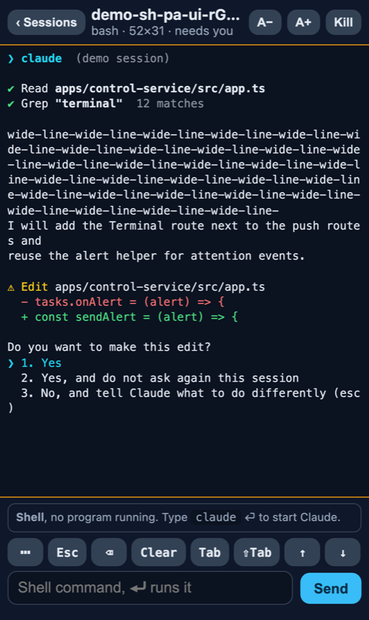
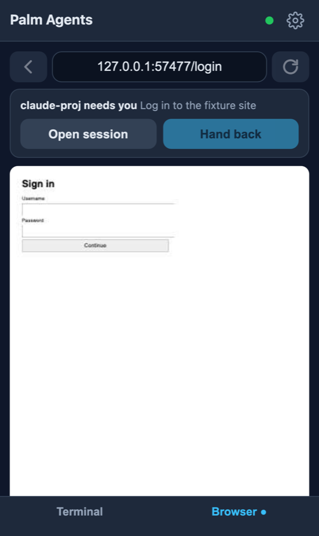

# Palm Agents

Run AI coding agents (Claude Code, Codex, any CLI) on a powerful machine, and manage them from the phone in your palm. The agents do the heavy work on the machine; the phone is the remote: start them, watch them, answer their questions and permission prompts, and step in when they need a human, for example to log in to a website.

<p>
  
  
</p>

> **Status:** a personal project, used daily by its author with a Mac and an iPhone. It works, but expect rough edges. The machine side is **macOS only** for now.
>
> **Security:** this is a remote control for your computer. A paired phone gets a shell on the machine. It is meant to be reachable only over your private [Tailscale](https://tailscale.com) network; never expose it to the internet. Read [docs/security.md](docs/security.md) before using it.

## What it does

- **Terminal sessions from the phone.** Agents run in ordinary tmux sessions on the machine, so they keep running when the phone disconnects, and you can open the same session at the desk. The phone shows each session at its own width, with a text box and a row of keys for what CLIs ask for (1/2/3, y/n, arrows, Esc, Ctrl-C).
- **Working / needs you / idle.** Every session shows whether it is busy or waiting. When one waits for an answer, you get a push alert that names the session; tapping it opens that session.
- **A shared, signed-in browser.** Agents get a browser tool (`palm-browser`, an MCP server) for web work. You watch it live on the phone and can drive it yourself. When a site needs a login or a code, the agent hands the browser to your phone; you sign in (password-manager autofill works) and hand it back. Only one of you controls it at a time.
- **From the phone into a session:** send a photo or screenshot to an agent, and open a dev server an agent started in the phone's own browser (shared on your tailnet only).

## How it fits together

- **Phone:** a web app (PWA) you add to the Home Screen. Built and tested on iPhone; Android with Chrome should work too but is untested.
- **Machine:** a small control service (Node.js) that manages the tmux sessions, the shared browser (Playwright Chromium with its own profile, never your personal one), push alerts and the agent bridge. It listens on `127.0.0.1` only.
- **Link:** Tailscale Serve gives the phone private HTTPS to the service. The phone is paired once with a one-time code.

## Quick start

You need a Mac, [Node.js](https://nodejs.org) 24+, tmux 3.2+ (`brew install tmux`), [Tailscale](https://tailscale.com/download) on the Mac and on the phone, and an agent CLI such as [Claude Code](https://docs.claude.com/en/docs/claude-code) or [Codex](https://github.com/openai/codex).

```sh
git clone https://github.com/sebandg/palm-agents.git && cd palm-agents
scripts/setup.sh            # dependencies, browser, build, environment check
scripts/install-launchd.sh  # run the service now and at every login
scripts/tailscale-serve.sh  # private HTTPS on your tailnet
scripts/connect-agents.sh   # give Claude Code and Codex the palm-browser tool
npm run pair                # one-time pairing code
```

On the phone, open the address `tailscale-serve.sh` printed (`https://<your-mac>.<your-tailnet>.ts.net`), enter the code, add the page to the Home Screen, and turn on alerts in Settings. The full walk-through is in [docs/setup.md](docs/setup.md).

## Compared with similar tools

- **[herdr](https://tecmint.com/herdr-run-ai-coding-agents-in-linux-terminal)** is a terminal multiplexer for agents when you are at a keyboard: panes, a sidebar, a local API. Palm Agents is the remote for when you are away from it: phone first, a shared browser with login hand-over, and push alerts. They combine: herdr can run inside a Palm Agents session.
- **Claude Code Remote Control** mirrors a Claude Code session to the Claude app. Palm Agents manages many sessions of any CLI agent and adds the shared browser.

More in [docs/alternatives.md](docs/alternatives.md).

## Documentation

- [Setup](docs/setup.md): installation, Tailscale, pairing, configuration
- [Security](docs/security.md): what is protected and what is not
- [Recovery](docs/recovery.md): what to do when something breaks
- [Testing](docs/testing.md): automated tests and what has been tried on real devices

## Development

```sh
npm start           # run the service in the foreground
npm test            # automated tests (need tmux and the Playwright Chromium)
npm run typecheck
npm run doctor      # environment and status check
```

Layout: `apps/control-service` (API, pairing, browser ownership, agent bridge, tmux), `apps/mobile-web` (Preact PWA), `packages/protocol` (shared types), `packages/browser-worker` (Playwright child process), `packages/mcp-bridge` (the `palm-browser` MCP tool), `packages/notifications` (Web Push), `scripts/`, `tests/`, `docs/`.

## License

[MIT](LICENSE)
